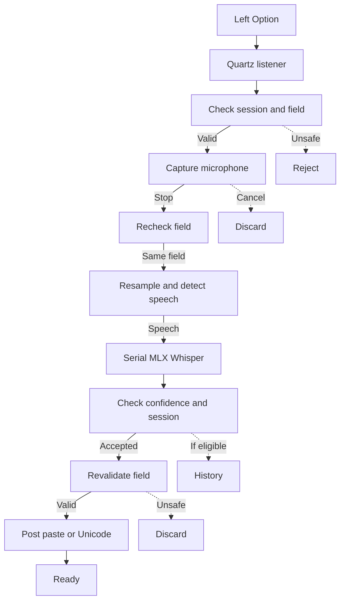
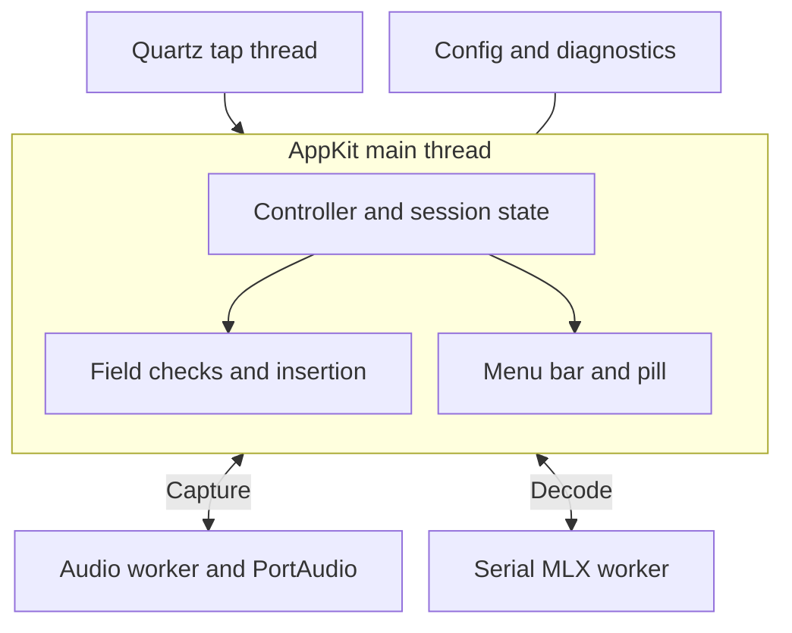

# VoiceToText

VoiceToText is a native macOS dictation app that converts speech to text on Apple Silicon using on-device MLX Whisper. It reduces repetitive typing in everyday editors and text fields while keeping audio and transcription on your Mac.

**Hold Left Option (⌥), speak, then release.** VoiceToText transcribes locally and inserts the result into the verified field. In Toggle mode, tap Left Option once to start and again to finish.


[](LICENSE)

[Install and use](#install-and-use) · [How it works](#how-dictation-works) · [Models and benchmarks](#models-and-benchmarks) · [Testing](#testing) · [Technical FAQ](#technical-faq)

## Capabilities

| Capability | What it does |
| --- | --- |
| Local dictation | Runs pretrained Whisper models through MLX on Apple Silicon. Cached models work offline. |
| Native controls | A global Quartz listener supports Hold and Toggle modes. A nonactivating AppKit pill shows recording and processing while the menu bar handles model choice, settings and permission checks. |
| Audio processing | Captures bounded mono audio, resamples to 16 kHz when needed, and uses adaptive frame-energy detection to skip nonspeech and trim quiet edges. |
| Text delivery | Verifies that the destination is editable and checks it again before sending text. Choose Fast paste or clipboard-free Quartz Unicode. |
| Vocabulary and recovery | Uses a custom vocabulary as a Whisper prompt. Eligible results, including low-confidence text, can be copied from temporary in-memory History. |
| macOS integration | Supports Escape cancellation, native permission checks, and optional startup at login. |

## Install and use

### Requirements and installation

Use an Apple Silicon Mac with **macOS 26 or later**, Homebrew's native framework build of **Python 3.12**, and Apple's Command Line Tools for Git and code signing. The supported installer uses hash-locked dependencies, including the macOS sounddevice wheel with PortAudio. Package installation and the first model download require network access.

```sh
brew install python@3.12
git clone https://github.com/vedpatel-real-ai/voice-to-text.git
cd voice-to-text
./install.sh
```

The installer places the app at `~/Applications/VoiceToText.app` and its runtime under `~/Library/Application Support/VoiceToText`. On first install it opens the menu-bar app. In **System Settings → Privacy & Security**, grant it **Microphone**, **Accessibility**, and **Input Monitoring**. Use **Check permissions** in the VoiceToText menu to confirm those grants and Event Posting access. Replacing an ad-hoc-signed bundle may require associating permissions with the new app identity.

### Set up a model

Quit VoiceToText before provisioning the default English model. Download its pinned files into the current user's Hugging Face cache, then reopen the app and wait for the model to become ready.

```sh
"$HOME/Library/Application Support/VoiceToText/runtime/.venv/bin/hf" download \
  mlx-community/whisper-small.en-mlx config.json weights.npz \
  --revision 52a88bf6e98b114a210c21bb83e22d6e1505cb73

open "$HOME/Applications/VoiceToText.app"
```

For medium.en provisioning, see [Model setup](docs/BENCHMARKS.md#model-setup). The app resolves existing cache entries and verifies the approved small.en and medium.en assets before loading them.

### Use the menu bar

- **Dictate.** Focus a regular editable text field. Hold Left Option, speak, and release. For Toggle, open **Settings → Option key behavior** and choose the press-again mode. Right Option is optional. Press Escape to cancel recording or discard in-flight transcription.
- **Choose a model or delivery mode.** Use **Settings → Model** for cached models and **Settings → Insertion** for Fast paste or Quartz Unicode.
- **Add vocabulary.** Choose **Settings → Edit vocabulary…**, save the file, then choose **Reload vocabulary**. The next inference uses the revised prompt.
- **Start at login.** After installation, run `./install.sh --enable-login` from the checkout to register the per-user LaunchAgent.

If the hotkey is quiet, use **Check permissions** and confirm Input Monitoring. If the app reports a private or unverified field in a regular editor, click the field, give the editor a moment to expose its accessibility tree, and retry. If the model fails to load, check that both model files were cached at the approved revision. [Bundle checks and recovery](docs/ARCHITECTURE.md#installation-and-rollback)

## How dictation works



1. **Capture.** The controller identifies the focused process, window, editable field and selection, then gives the audio worker a recording session. Stopping requires the original destination to remain valid.
2. **Decode.** The worker returns mono audio. The inference path checks duration, detects speech and calls the selected Whisper model with the vocabulary prompt. Whisper's segment scores help decide whether to deliver the result or offer it in History.
3. **Deliver.** The controller discards stale or protected results. The insertion module rechecks permissions, destination and selection before posting to the target process. macOS and the editor determine when the event is consumed. The app returns to ready after delivery, recovery or rejection.

## Architecture



The event tap queues key events so the main thread can own the UI and session transitions. A dedicated worker owns stream open, stop and abort, keeping device operations off the UI thread. One inference worker serializes warm-up, model switches and decoding, and a transcriber lock guards direct callers. Session generations let the controller discard callbacks from cancelled or superseded sessions.

| Module | Responsibility |
| --- | --- |
| [`voice_to_text.py`](voice_to_text.py), [`statemachine.py`](statemachine.py) | AppKit controller, session generations, History, menu and explicit state transitions |
| [`hotkey.py`](hotkey.py), [`permissions.py`](permissions.py) | Global Option events and macOS permission preflights |
| [`audio.py`](audio.py), [`transcription.py`](transcription.py) | Capture, resampling, speech detection, model cache, inference and confidence checks |
| [`injection.py`](injection.py) | Destination validation, process-directed events and clipboard transactions |
| [`pill.py`](pill.py), [`config.py`](config.py), [`diagnostics.py`](diagnostics.py) | Floating status, preferences and vocabulary, local diagnostics and timing |

### Technology stack

| Technology | Role |
| --- | --- |
| Python 3.12 | Coordinates the app and its pinned native dependencies. |
| Apple MLX and MLX Whisper | Run pretrained speech recognition on the Apple Silicon GPU. |
| Quartz, PyObjC and AppKit | Bridge native keyboard events, accessibility, pasteboards and the floating UI. |
| PortAudio and sounddevice | Provide callback-driven microphone capture and input-rate negotiation. |
| NumPy and SciPy | NumPy handles sample processing and resampling. SciPy is a pinned scientific dependency. |
| rumps and py2app | Provide the menu bar and macOS app launcher. |
| pytest and GitHub Actions | Define the local regression suite and hosted verification workflow. |

[Thread ownership, installation and privacy safeguards](docs/ARCHITECTURE.md)

## Models and benchmarks

VoiceToText integrates and evaluates pretrained Whisper models via MLX Whisper. MLX uses Apple Silicon's GPU and unified memory for local inference. **small.en** is the default because it used less active MLX memory and returned results sooner than **medium.en** on the matched workload. Medium.en made fewer word errors on the public read-speech subset.

| Model | Read-speech WER ↓ | Warm inference p95 ↓ | Active MLX memory ↓ |
| --- | ---: | ---: | ---: |
| **small.en** · English default | 3.40% | 397 ms | ~484 MB |
| **medium.en** · English | 2.26% | 1,096 ms | ~1,528 MB |

Word error rate (WER) counts substituted, deleted and inserted words relative to the number of reference words. The comparison uses one matched, offline 3.0.2 benchmark replay from before the destination correction, run on an Apple M5 with 16 GB of unified memory. Normalized WER here covers 17 public read-speech clips from LibriSpeech and CMU Arctic. Warm p95 covers all 26 speech clips, including synthetic and modified samples. Active MLX memory is the allocator reading immediately after warm-up. Editor visibility also depends on capture finalization, delivery and the receiving app.

The model menu also includes English-only **tiny.en** and multilingual **large-v3** for already-cached snapshots. The matched evaluation covers small.en and medium.en. [Corpus, scoring, measurements and reproduction](docs/BENCHMARKS.md)

## Privacy and reliability

Audio is buffered in memory and decoded locally. The normal inference path resolves models from the filesystem and does not upload audio or transcripts. Setup downloads dependencies and model files. Destination checks inspect accessibility metadata and selection offsets. If Secure Event Input is active or the field cannot be verified, the app rejects the session. It checks again during capture and processing, and immediately before delivery.

Fast paste temporarily stages text on the system clipboard. It restores readable representations while the transaction still owns the clipboard. Other apps can observe the temporary text, and delayed or promised clipboard data has platform limits. Quartz Unicode avoids that transaction. Transcripts eligible for History stay in memory for a bounded period or until the app quits. [Privacy boundaries and failure handling](docs/ARCHITECTURE.md#privacy-and-delivery-boundaries)

## Testing

The clean 3.0.2 runtime passed **140 automated tests** locally, including the opt-in installed-app check. Coverage was **55.7% statements / 48.7% branches** across the top-level Python modules and **83.1% / 77.4%** in destination validation and insertion. The suite exercises session cancellation, audio handling, model and vocabulary behavior, native accessibility and Unicode events, clipboard faults, and installer rollback. The operator confirmed that dictation works during normal use on installed 3.0.2 and that the earlier Option-key and erroneous private-field issues are resolved in that usage. The full physical acceptance matrix remains open. [Verification record](docs/TESTING.md)

Run the suite on macOS from a separate development environment with the checked-in test dependencies.

```sh
"$(brew --prefix python@3.12)/bin/python3.12" -m venv .venv
. .venv/bin/activate
python -m pip install --require-hashes -r bootstrap.lock
python -m pip install --require-hashes -r build.lock
python -m pip install --require-hashes --no-build-isolation -r requirements-dev.lock
python -m pip check
HF_HUB_OFFLINE=1 python -m pytest -q -rs
```

[Verification record, coverage scope and installed-app check](docs/TESTING.md)

## Limitations

- **Platform and models.** The supported runtime targets Apple Silicon macOS. Small.en, medium.en and tiny.en are English-only. Large-v3 offers multilingual recognition outside the matched evaluation. Model files must be provisioned for each account or made available in its cache.
- **Editor compatibility.** Delivery depends on what an app exposes through Accessibility. Secure, read-only, and unverified fields are rejected. A focus change between the final check and event consumption is still possible. The app's delivery status records the Quartz post.
- **Capture and latency.** Dictation is capped at 60 seconds by default and transcribes after the stop gesture. Warm inference results from this small benchmark do not establish accuracy for spontaneous speech or release-to-visible latency in real editors.
- **Native acceptance.** Full foreground editor, permission-transition, external microphone, sleep/wake and login testing remain open for the clean build. Local bundle signing and controlled native tests cover a narrower scope. [Acceptance scope](docs/TESTING.md#physical-acceptance)

## Technical FAQ

**Does VoiceToText need an internet connection?**\
Install dependencies and download the selected model while online. During dictation, the app resolves model files locally, so a cache miss requires a separate download before that model can run.

**Why can a newly focused editor need another Option press?**\
Some hosts load their accessibility tree lazily. VoiceToText can request the tree, then needs a later inspection to confirm which editable field has focus.

**Why can recording remain unavailable briefly after Escape?**\
Escape invalidates the session immediately. An MLX operation already running can take time to return, and VoiceToText waits for it before starting another recording.

**What does custom vocabulary change?**\
The app passes the vocabulary to Whisper as an initial prompt. It can influence recognition of names and technical terms. Review the resulting text when exact spelling matters.

**What happens if I switch editors while processing?**\
The app blocks automatic delivery to the new destination. When the new field is verifiable, the result may be available for explicit copy from History. Protected or unverified destinations cause it to be discarded.

**Why can Fast paste miss in a busy editor?**\
The target app consumes Command-V asynchronously. A slow target can read the clipboard after the original contents have been restored. Quartz Unicode sends text through keyboard events and can be tried in compatible fields.

**Can I move the app bundle to another Mac?**\
The py2app alias references a per-user runtime created by the installer. Run the documented installer on the other Mac to create its own runtime and grant permissions there.

## Project documentation

[Architecture and privacy](docs/ARCHITECTURE.md) · [Benchmarks](docs/BENCHMARKS.md) · [Testing and acceptance](docs/TESTING.md) · [3.0.2 release notes](docs/engineering-implementation/release-3.0.2.md) · [Changelog](CHANGES.md) · [MIT license](LICENSE)
